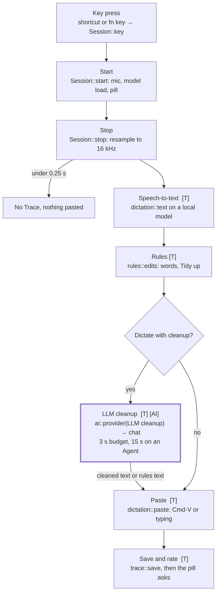
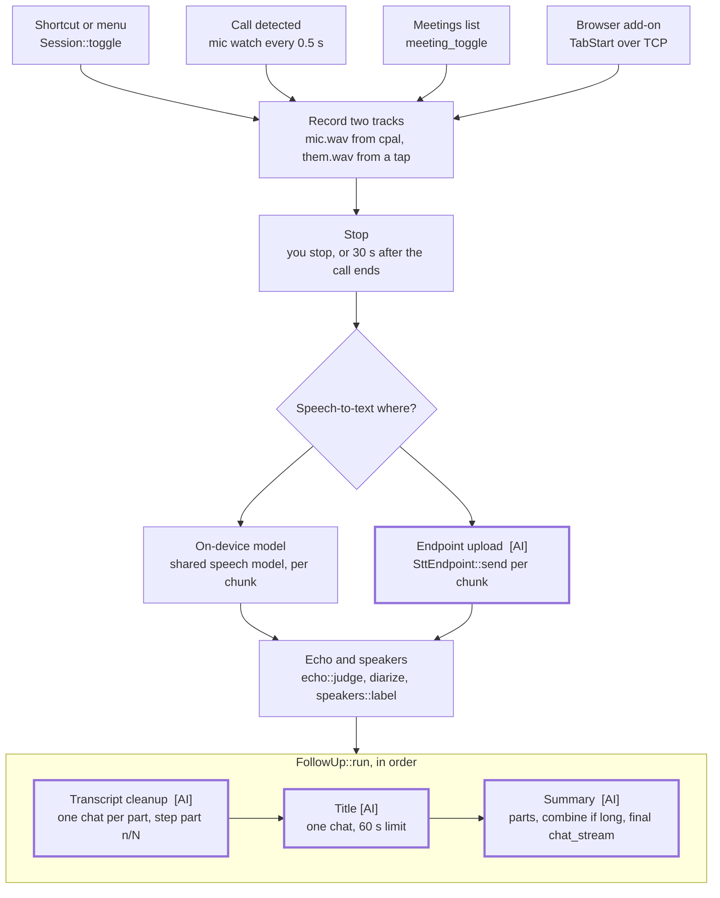

# How Myna works: voice typing and meeting notes, end to end

As of 0.0.2-beta.23. File and line references point at the code at that release.

## Overview

Voice typing writes to Stats for nerds; meeting notes write only to the AI log. Each dictation leaves one Trace with up to three Steps (speech-to-text, rules, cleanup), and only its optional LLM cleanup is an AI call. A meeting leaves no Trace, but every AI call it makes after you stop (cloud speech-to-text, transcript cleanup, title, summary) is an AI log entry.

- **Shared AI layer:** every AI call goes through `ai::provider()`, which returns a `Backend` for an Endpoint (HTTP) or an Agent (a sandboxed CLI run). While the AI log is on, that backend is wrapped by `ai_log::Logged`, which writes one entry per call to `ai-log.jsonl` and emits the `ai-log` event.
- **On-device work** (Parakeet, Whisper, Apple Speech, Voz, Sortformer, Who, rules, echo) never appears in the AI log.
- **In the diagrams:** **T** = writes a Trace step or field (Stats for nerds), **AI** = writes an AI log entry.

## Voice typing, from key press to paste

A dictation stays on your Mac until the optional cleanup, the only step that can leave it. Plain dictation makes no AI call.

1. **Key press.** A shortcut reaches `Shortcuts::dispatch` (`shortcuts.rs:165`); the fn key comes through a CGEventTap in `fnkey::watch` (`fnkey.rs:29`). Both end in `Session::key` (`session.rs:129`), with `clean` set for Dictate with cleanup. Hold starts on press; Tap toggles on release. Esc calls `Session::cancel`: nothing pasted, no Trace.
2. **Start.** `Session::start` (`session.rs:217`) checks the mic, Accessibility and the speech model, starts the Trace with the front app (NSWorkspace), opens the mic (`dictation::record`, cpal), shows the pill (`dictation` event) and loads the model in the background. The pill gets `dictation-level` every 50 ms.
3. **Stop.** `Session::stop` (`session.rs:280`) finishes the recording and resamples to 16 kHz. Under 0.25 s it ends with no Trace.
4. **Speech-to-text.** `dictation::text` (`dictation.rs:188`) runs the chosen local engine: Parakeet (ONNX), Whisper (whisper.cpp), Apple Speech (Swift bridge) or Voz. Words to remember bias the model first. **T:** step `speech-to-text`, plus the model-load wait.
5. **Rules.** `rules::edits` (`rules.rs:402`) applies Words to remember and Tidy up, locally. **T:** step `rules` with its edits.
6. **LLM cleanup** (Dictate with cleanup only). `Session::cleanup` (`session.rs:411`) opens the Fast model through `ai::provider(…, "LLM cleanup")`, then `cleanup::run` (`cleanup.rs:217`) calls `chat` with a 3 s budget (15 s for an Agent). Too slow, no Fast model or a failed guard pastes the rules text instead, and the pill says why. **T:** step `cleanup` with model, cost and any fallback. **AI:** one entry, feature LLM cleanup; a reply that lands after the budget is still logged.
7. **Paste.** `dictation::paste` (`dictation.rs:198`) saves the clipboard, sends Cmd-V, waits 300 ms and restores it, or types the text as keystrokes. **T:** outcome and paste time.
8. **Save.** `trace::save` (`trace.rs:43`) writes the Trace and its Steps in one transaction; `trace::sweep` applies Keep history.
9. **Rate.** If rating is on, the pill asks (`dictation-ask`); thumbs go to the `feedback` table, which Stats for nerds joins as the rating.

## Meeting notes, from start to summary

Nothing is transcribed while you record; all the work, and every AI call, happens after you stop.

1. **Start.** Four ways in: the meeting shortcut or menu bar (`MeetingSession::toggle`, `meeting_session.rs:67`); the call-detected pill, from `calls::Watcher::poll` checking which apps hold the mic every 500 ms (`calls.rs:118`, then `call_start`); the Meetings list; or the browser add-on (`addon.rs:327`, `TabStart`).
2. **Record.** `Meetings::start` (`meeting.rs:730`) adds a `meeting` row and writes two tracks: your mic (`mic.wav`, cpal) and the other people (`them.wav`), from a Core Audio process tap through the Swift bridge, or the call tab's sound from the add-on.
3. **Stop.** `MeetingSession::stop` (`meeting_session.rs:157`), or automatically 30 s after the call app lets go of the mic, unless you keep it. `Meetings::stop` (`meeting.rs:1245`) finalises the WAVs.
4. **Transcribe.** `write_up` (`meeting_session.rs:316`) asks `stt::resolve` (`stt.rs:49`) for Local or Endpoint, then `Meetings::transcribe` (`meeting.rs:986`) runs per chunk: on-device with the shared speech model, or uploaded in parallel to `SttEndpoint::send` (`ai.rs:507`, HTTP). Silent chunks aren't uploaded; muted or private mic stretches always stay local. **AI:** Meeting speech-to-text, one entry per uploaded chunk.
5. **Echo and speakers.** `echo::judge` (`echo.rs:49`) marks lines that echoed into your mic; `Session::diarize` (`session.rs:399`) tells voices apart (Sortformer or Who, on-device); `speakers::label` (`speakers.rs:21`) matches them to caption names. Segments are saved and the meeting is done.
6. **Follow-up.** `FollowUp::run` (`follow_up.rs:34`) runs three AI jobs in order, then compacts the audio to AAC:
    1. **Transcript cleanup** (`transcript.rs:82`), if on: one `chat` per part. **AI:** Transcript cleanup, step part n/N.
    2. **Title** (`title.rs:46`), while the meeting is Untitled: one `chat`, 60 s limit. **AI:** Title.
    3. **Summary** (`summary.rs:230`), if automatic Summary is on: a `chat` per part (cached in `chunk_note`, so a cache hit makes no call), a `combine` call only when the notes overflow the model's context, then one streamed `chat_stream`. **AI:** Summary, steps part n/N, combine, then none.
7. **Regenerate** on the meeting page runs the Summary again (`FollowUp::regenerate`, `follow_up.rs:47`), with the same AI log entries.

Unfinished meetings are written up again at the next launch (`meeting_session.rs:217`).

## What reaches Stats for nerds

Stats for nerds reads only dictation Traces: one row per dictation longer than 0.25 s, plus one Step row per stage it reached. Meetings never write one.

| Trace field | What it holds | Filled at |
| --- | --- | --- |
| started | when recording began (unix ms) | Start |
| mode | hold or tap | Start |
| app, bundle | the app in front (NSWorkspace) | Start |
| model | the speech model used | Speech-to-text |
| audio_ms | length of the recording | Stop |
| load_ms | wait for a cold speech model | Speech-to-text |
| outcome | pasted, not_pasted, nothing_heard or failed | Paste |
| reason | the error, if any | Save |
| paste_ms | key release to pasted | Paste |
| rating | your thumbs up or down, joined from `feedback` | Rate |

| Step kind | text | settings and edits |
| --- | --- | --- |
| speech-to-text | the raw transcript, with its time | none |
| rules | the text after rules, with its time | language and Tidy up; every edit made |
| cleanup (Dictate with cleanup only) | the cleaned text, or the fallback text | model, cost, fallback reason and detail |

The Overview (`stats.ts`) charts time per stage (model load, speech-to-text, rules, cleanup, paste) and outcomes; a dictation's detail view (`Traces.svelte`) shows the edits and the cleanup.

## What reaches the AI log

One entry per call to an AI provider, only while Settings › Experimental and its AI log switch are both on. A call blocked before it went out (Agents off, provider gone) is logged as Blocked.

| Feature label | Step label | Method | Calls per run | Comes from |
| --- | --- | --- | --- | --- |
| LLM cleanup | none | chat | 1 per dictation, Dictate with cleanup only | Voice typing |
| Meeting speech-to-text | none | transcribe | 1 per uploaded chunk, Endpoint only | Meeting notes |
| Transcript cleanup | part n/N | chat | 1 per part, if on | Meeting notes |
| Title | none | chat | 1, while Untitled | Meeting notes |
| Summary | part n/N | chat | 1 per uncached part | Meeting notes, Regenerate |
| Summary | combine | chat | 1, only when notes overflow the context | Meeting notes, Regenerate |
| Summary | none | chat_stream | 1 final summary | Meeting notes, Regenerate |
| Decision | none | decide | 1 per Try in AI providers | Settings only, for now |
| Test | none | check, models, key_usage, transcribe | per Test press | Settings › AI providers |

Each entry holds the feature, provider and model, the system prompt and prompt as sent, the final text, the raw reply (up to 256 KB), the outcome and error, time to first token (streamed calls only), total time, tokens and cost. Cloud speech-to-text entries hold the clip length and segments, never the audio.

## Coverage at a glance

| Flow | Stage | Runs where | Stats for nerds | AI log |
| --- | --- | --- | --- | --- |
| Voice typing | Key press, start, stop | On device | Trace fields | No |
| Voice typing | Speech-to-text | On device | Step speech-to-text | No |
| Voice typing | Rules | On device | Step rules | No |
| Voice typing | LLM cleanup | AI provider | Step cleanup | LLM cleanup |
| Voice typing | Paste, rating | On device | Outcome, paste time, rating | No |
| Meeting notes | Start, record, stop | On device | No | No |
| Meeting notes | Speech-to-text, local model | On device | No | No |
| Meeting notes | Speech-to-text, Endpoint | AI provider | No | Meeting speech-to-text |
| Meeting notes | Echo, speakers | On device | No | No |
| Meeting notes | Transcript cleanup | AI provider | No | Transcript cleanup |
| Meeting notes | Title | AI provider | No | Title |
| Meeting notes | Summary | AI provider | No | Summary |
| Settings | Test, Try | AI provider | No | Test, Decision |

Open question: meetings have no Trace, so nothing shows how long transcription, speaker matching or the follow-up took. The AI log covers only the AI calls among them.
